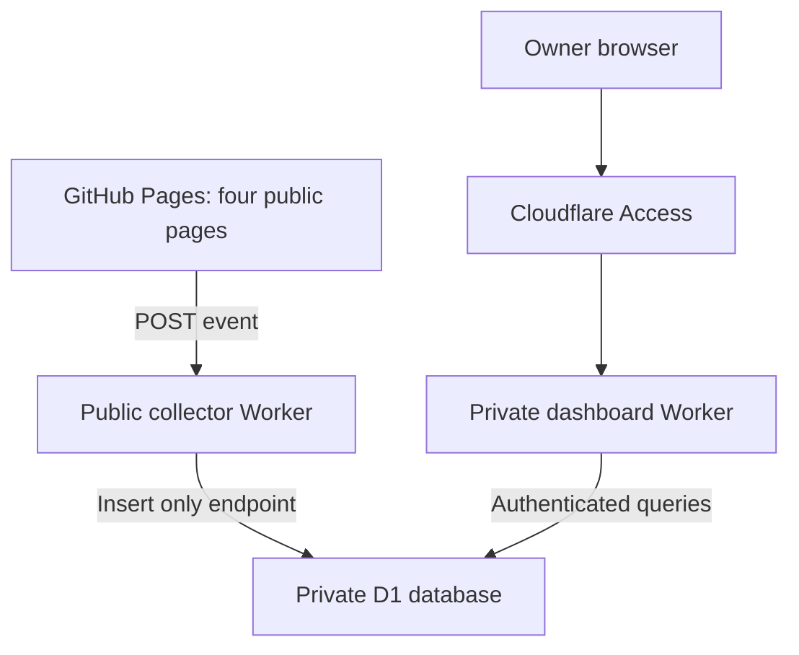

# Private visitor analytics

Status: Cloudflare backend deployed and verified on 26 October 2026. Owner sign-in, anonymous denial, live edge metadata and replay deduplication passed. Public collection is enabled by the accompanying Pages release.

Owner dashboard: https://yang-portfolio-analytics.sgyliu.workers.dev/admin/

Sign in with the Cloudflare account for sgyliu@gmail.com, or request an email login code for that exact address. This dashboard is not linked from the public homepage.

## Scope and architecture

The existing GitHub Pages portfolio remains the public website. Four primary pages (English
and Chinese homepage and CV) load a small deferred, independent script. There is no public
counter, sign-in link, consent prompt or privacy notice added by this feature.



Two independent Workers separate collection from reading. The collector exposes only
POST /collect and a CORS preflight. It has no statistics or dashboard route.
The admin Worker authenticates every route, including HTML, CSS, JS, JSON and CSV, against
Cloudflare's verified `ctx.access`, the expected application audience and exactly one
owner email. A forged JWT/email header, missing Access configuration or wrong account fails
closed. No Static Assets binding is used because it prevents this direct Access context
from reaching the Worker in the current platform routing model.

## Data and counting

| Item | Behaviour |
| --- | --- |
| Pageview | One visible page load, using an ephemeral per-navigation UUID solely to deduplicate replays |
| IP | Cloudflare edge `CF-Connecting-IP`; never client body or X-Forwarded-For |
| Approximate location | Cloudflare country/region/city; missing values remain unknown |
| Visitor identity | Not determined: IP is a network exit, not a named person or reliable headcount |
| Stored fields | UUID, server UTC timestamp/day, allowlisted page path, IP, country, region, city |
| Excluded | Query strings, fragments, referrer, user-agent storage, cookies, localStorage, fingerprint, GPS |
| Raw details | Queryable for the last 30 days; hourly deletion from the live events table |
| Daily aggregate | Counts only, retained 365 days |
| Lifetime aggregate | Counts plus first/last timestamps per page, retained until explicitly deleted |
| Backups | D1 Time Travel has independent recovery retention: currently 7 days Free / 30 days Paid |
| Date controls | UTC, including a potentially partial oldest day |
| Export | Authenticated CSV, maximum 10,000 rows; larger requests explicitly fail |
| Own visits | Included by default; optional comma-separated `EXCLUDED_IPS` collector variable |

No persistent visitor identifier is used. DNT/GPC are respected. Known automated user agents
and verified bots are filtered, but this is not a complete bot detector. Ad blockers, JS
disabled, transient network failures and privacy signals cause undercounting. Origin
validation prevents ordinary cross-site browser submission, but a non-browser client can
forge Origin: this public endpoint cannot prove that every accepted event is human.
A Cloudflare limiter targets 60 requests/IP/minute per edge location (approximate), with a
separate atomic 20,000 accepted-event daily database cap. Shared networks can be limited.
Counter history starts at activation; historical GitHub Pages visits cannot be recovered.

No banner or notice is included. Cookieless operation does not by itself establish lawful
processing of raw IP-level analytics. This implementation makes no legal-compliance claim.

## Implementation and checks

- `src/collector.mjs`: bounded request parsing, origin/method/path checks, edge metadata,
  bot/privacy filters, rate limits and atomic idempotent insertion.
- `migrations/0001_events.sql`: events, daily/lifetime counts, trigger and query indexes.
- `src/admin.mjs`: fail-closed authentication, bounded date filtering, cursor pagination,
  CSV escaping and private no-store responses.
- `src/dashboard.mjs`: responsive Chinese owner interface, safe text rendering, date
  filters, daily chart, countries/pages, detail table, CSV, sign out and expired-session errors.
- `../public/assets/js/analytics*.js`: silent collector, no storage, no visible page changes.
- `test/`: SQLite-backed behaviour/authentication tests and real Chromium browser acceptance.

Run from the repository root with Node 24:

```powershell
npm --prefix analytics ci
npm run check
npm run test:analytics
npm run test:browser
```

On Windows the browser test uses installed Chrome with a clean temporary profile. On Linux
run `npm --prefix analytics exec -- playwright install --with-deps chromium` first.
Test screenshots and synthetic data stay in ignored `.local/analytics-qa/`.
Only synthetic RFC 5737 / RFC 3849 addresses are used in fixtures.

Cloudflare's pinned local runtime supports compatibility dates through 2026-10-03.
Both Worker configurations use that date. A newer calendar date must not be introduced
without verifying that the pinned workerd binary supports it.

## First deployment

Commands below are run in `analytics/`. Do not place credentials, exports or deployment
receipts in the public repository or `public/`. `.private/`, `.wrangler/`, `.env*` and
`.dev.vars*` are ignored. Use the existing account; no paid-plan upgrade is required
by these steps and no automatic billing change is made.

1. For a fresh deployment, authenticate Wrangler using the account that owns `sgyliu.workers.dev`:

   ```powershell
   node node_modules/wrangler/bin/wrangler.js login --use-keyring --scopes account:read user:read workers_scripts:write d1:write
   node node_modules/wrangler/bin/wrangler.js whoami --json
   ```

2. Create a dedicated database, leaving existing project buckets/readers untouched:

   ```powershell
   node node_modules/wrangler/bin/wrangler.js d1 create yang-portfolio-analytics --location weur
   ```

3. In Cloudflare Zero Trust create a self-hosted Access application protecting the entire
   hostname `yang-portfolio-analytics.sgyliu.workers.dev` (all paths), with One-time PIN
   and an Allow policy for **only `sgyliu@gmail.com`**, not the Gmail domain. Copy its
   Application Audience (AUD). Do not protect the public collector with this login policy.
   If account-level Access protects all Workers, explicitly configure public collection
   for this collector only; do not weaken any other Worker policy.

4. Generate ignored deployment configuration:

   ```powershell
   node scripts/configure.mjs ACCOUNT_ID D1_DATABASE_ID ACCESS_AUD
   node node_modules/wrangler/bin/wrangler.js d1 migrations apply yang-portfolio-analytics --remote --config .private/collector.json
   npm run deploy:admin
   npm run deploy:collector
   ```

   The collector initially has `COLLECTION_ENABLED: "false"`. Admin refuses data when
   authentication is not configured. Preview URLs are disabled for both Workers.
   Once the admin Worker exists, prefer Worker-level Access protecting All traffic,
   with the same single-email policy; set `ACCESS_AUD` to that application's AUD and
   redeploy. This also protects any future hostname attached to that Worker.

5. Sign in to the admin as the owner and confirm the empty dashboard works. In a clean
   browser confirm both dashboard and API require login, and confirm another identity
   cannot query. Set `COLLECTION_ENABLED` to `"true"` in ignored collector config and
   redeploy. Run `npm run check:deploy`. That script checks anonymous protection,
   forged-header denial, route separation, CORS and input validation, but is **not**
   a substitute for owner sign-in or a production end-to-end pageview check.

6. In a browser with DNT/GPC off, run a temporary test page with the actual collector,
   record one expected increment, replay the same event UUID, and confirm no second
   increment in D1. This creates a real deployment-test event; document it rather than
   silently pretending it is a real visitor. Confirm country/IP use real edge metadata.

7. Only after the preceding checks pass, set `public/assets/js/analytics-config.js` to:

   ```js
   window.YL_ANALYTICS = Object.freeze({
     enabled: true,
     endpoint: 'https://yang-portfolio-events.sgyliu.workers.dev/collect'
   });
   ```

   Run `npm run sync:root`, `npm run check`, `npm run test:analytics` and browser tests,
   commit and deploy the Pages change. Verify the live English/Chinese homepage and CV,
   no public metrics or prompts, actual request response and owner-only count increase.
   Do not label deployment complete until this live check succeeds.

## Rollback and maintenance

Disable `COLLECTION_ENABLED` and redeploy the collector for immediate ingestion stop;
set the public enabled flag false, sync and redeploy Pages to stop outbound requests.
Keep the private dashboard available for reviewing/deleting retained data. The existing
homepage does not depend on collector availability.

Hourly cron must remain enabled. Query-side retention prevents stale rows being shown
when a cron is delayed, but it does not replace physical deletion. Check Worker scheduled
invocations and periodically confirm `MIN(occurred_at)` is within the retention window.
After restoring D1 from Time Travel, run retention before resuming collection; restored
aggregates may reflect the restored snapshot. Do not enable D1 read replicas without
revisiting the read-consistency assumptions. Review Cloudflare plan usage/quota in the
account dashboard; free allowance is not a guarantee against all traffic or cost.

## Primary references

- [Cloudflare Access and ctx.access](https://developers.cloudflare.com/workers/configuration/cloudflare-access/)
- [Cloudflare request metadata](https://developers.cloudflare.com/workers/runtime-apis/request/)
- [Rate-limiting binding and accuracy](https://developers.cloudflare.com/workers/runtime-apis/bindings/rate-limit/)
- [D1 Time Travel retention](https://developers.cloudflare.com/d1/reference/time-travel/)
- [ICO storage/access exceptions and individual visitor analytics](https://ico.org.uk/for-organisations/direct-marketing-and-privacy-and-electronic-communications/guidance-on-the-use-of-storage-and-access-technologies/what-are-the-exceptions/)
